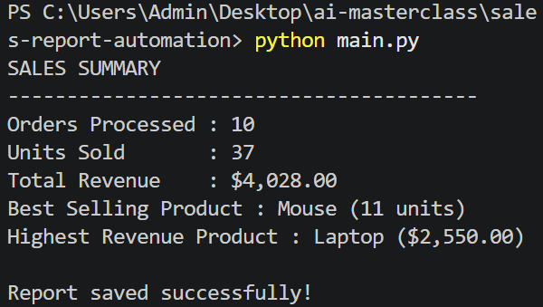
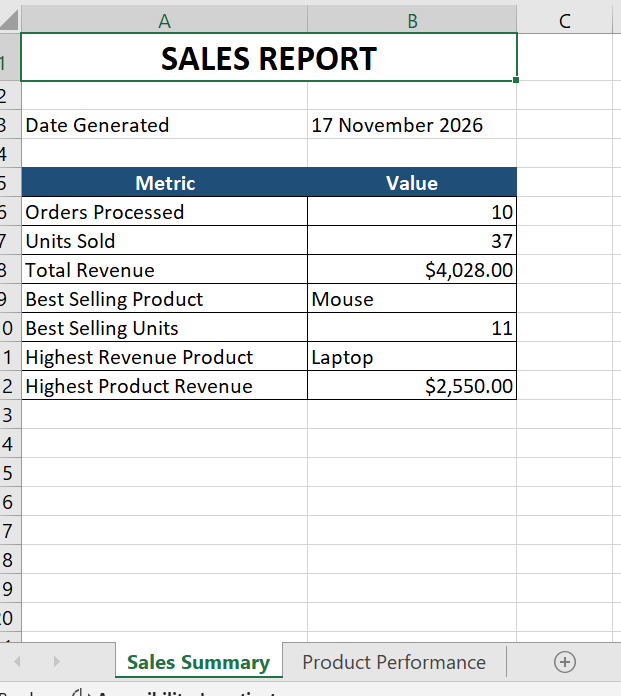
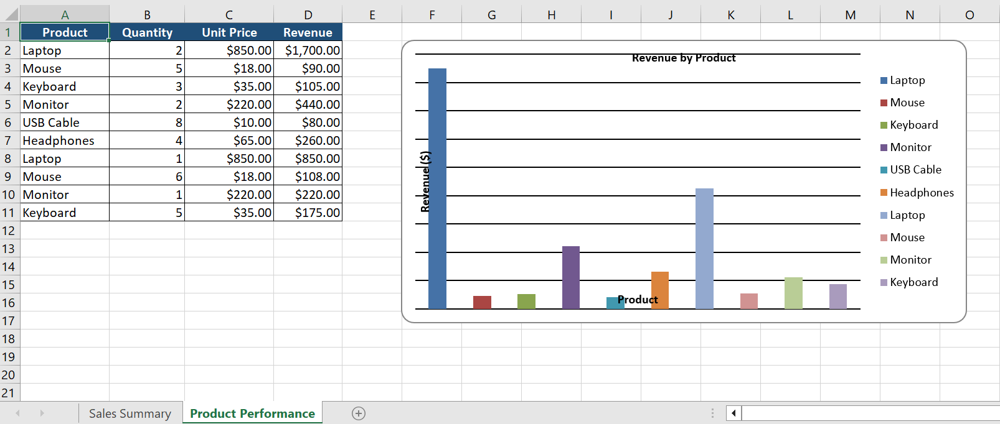

# 📊 Sales Report Automation

A Python automation project that reads sales data from a CSV file, analyzes it, and automatically generates professional text and Excel reports.

---

## 🚀 Features

- Read sales data from a CSV file
- Calculate total orders
- Calculate total units sold
- Calculate total revenue
- Identify the best-selling product
- Identify the highest revenue product
- Generate a formatted text report
- Generate a professional Excel report
- Create multiple worksheets
- Automatically generate a bar chart
- Format currency and auto-size columns

---

## 🛠 Technologies Used

- Python 3
- OpenPyXL
- PyTest

---

## 📁 Project Structure

```text
sales-report-automation/
│
├── data/
│   └── sales.csv
│
├── reports/
│   ├── sales_report.txt
│   └── sales_report.xlsx
│
├── tests/
│
├── calculations.py
├── data_loader.py
├── excel_report_generator.py
├── logger.py
├── main.py
├── report_generator.py
├── requirements.txt
└── README.md
```

---

## ⚙ Installation

Clone the repository:

```bash
git clone https://github.com/YOUR_USERNAME/sales-report-automation.git
```

Navigate into the project:

```bash
cd sales-report-automation
```

Install dependencies:

```bash
pip install -r requirements.txt
```

---

## ▶ Running the Project

```bash
python main.py
```

---

## 📊 Console Output

```text
SALES SUMMARY
----------------------------------------
Orders Processed : 10
Units Sold       : 37
Total Revenue    : $4,028.00
Best Selling Product : Mouse (11 units)
Highest Revenue Product : Laptop ($2,550.00)

Report saved successfully!
```

---

## 📈 Excel Report

The generated workbook contains:

- Sales Summary worksheet
- Product Performance worksheet
- Revenue by Product bar chart
- Currency formatting
- Auto-sized columns

## 📷 Screenshots

### Console Output



### Sales Summary Worksheet



### Product Performance Worksheet



---

## 🧪 Running Tests

```bash
pytest
```

---

## 📚 Skills Demonstrated

- Python Programming
- File Handling
- CSV Processing
- Data Analysis
- Functions
- Modular Programming
- Excel Automation
- Data Visualization
- Automated Testing
- Logging

---

## 🔮 Future Improvements

- PDF report generation
- Interactive dashboard
- Email report automation
- Database integration
- Scheduled report generation

---

## 👨‍💻 Author

Created as part of a Python automation learning journey and portfolio.